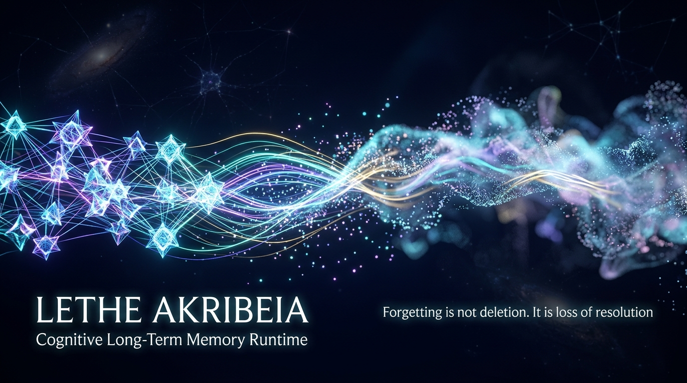
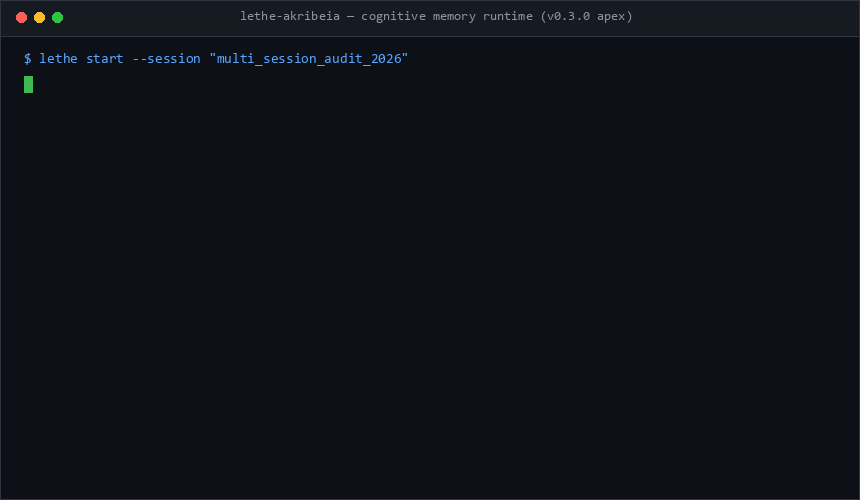

<div align="center">



# Lethe Akribeia

**AI エージェントのための実験的・長期メモリランタイム**

[ [English](README.md) | **日本語** ]

[](https://www.python.org/downloads/)
[](https://opensource.org/licenses/MIT)
[](#ステータスとロードマップ)
[](#再現手順)
[](#再現手順)

> *“忘却とは削除ではない。解像度の低下である。”*

忘却を「完全削除」ではなく「段階的な解像度の低下」として扱うメモリシステムです。  
*決定論的メモリコンパイル · 時間推論 · エビデンス出所追跡 · MCP ネイティブ*  
*(旧称: Artificial Memory / `lethe-akribeia`)*

<br />



<br />

</div>

---

## 計測ステータス — 数値を引用する前に必ず読んでください

> [!WARNING]
> **本プロジェクトは最先端（SOTA）ではありません。これまでのリリースで公表した数値のいくつかは、
> 再採点した結果、公表値より低くなりました。** 以下では、どの数値が生き残り、どれが
> そうでないか、その差は何なのかを、根拠となる成果物・文書へのリンク付きで示します。

**1. LoCoMo の公式 token F1（固定版アップストリーム採点器、1,986問）。**
当初公開したパイプラインは **37.41%**（カテゴリ1–4 では **48.24%**）。そこから
2つの計測済み変更で改善します。ベンチマーク規定の拒否表現（`not mentioned`）を
出すだけで **49.91%**（これは能力向上ではなく**書式の修正**です）。さらに
answer-provenance 拒否ゲートを有効化し、決定論的 committer を無効化すると
**54.94%**。この最後の値は「ゲート有効で 53.77%、committer 無効化で +1.16pt」という
対応のある差分の合成値であり、単一の保存済みランではありません。v0.3.0 の成果物を
同じプロトコルで再採点すると **51.89%** です。出典:
[`design_docs/v4_world_class/V4_PROGRAM.md`](design_docs/v4_world_class/V4_PROGRAM.md) §2, §4.9, §4.17、
成果物: [`official_locomo_score_v4r7_aligned.json`](benchmark_results/official_locomo_score_v4r7_aligned.json)、
[`..._v4r7_refusal_form.json`](benchmark_results/official_locomo_score_v4r7_refusal_form.json)、
[`..._v030_rules_commit.json`](benchmark_results/official_locomo_score_v030_rules_commit.json)。

**2. バイナリ一致率 `65.26%` は公式 F1 ではなく、公式 F1 と比較できません。**
これは自作の決定論的マッチャによる値で、しかも LoCoMo カテゴリ5 では旧ハーネスが
`adversarial_answer` を正解として使っていました。その結果、126問が「誤答の選択肢に
一致した」だけで正解扱いになっていました。公式採点器ではこのカテゴリは **0.00%** です。
65.26% はカテゴリ1–4 のみの値です。出典: V4_PROGRAM §3.1。

**3. LongMemEval の数値（Oracle Recall 98.20%、E2E 83.40%）は v0.3.0 の成果物です。**
ローカル 7B Reader と自作採点器による 500問・1回のランです。公開されている
LongMemEval の 95%+ という数値は別の回答モデルと LLM 審判を使っており、
同一ハーネスでの直接比較は本リポジトリには存在しません。

**4. BEAM の `500K で 20/20` は needle-in-a-haystack の探針テストであり、
BEAM リーダーボードの結果ではありません。** 公開 BEAM 数値は LLM 審判を使います。
本件は 500K トークン・20問に対する自作バイナリマッチャの結果です。

**5. 出荷時デフォルト設定のランタイムは、統制アリーナ（200問）で 11.5% でした。**
IDF 重み付きレキシカル検索チャネルを有効にすると **53.0%** になります
（Simple RAG 51.0%、Mem0 風 42.5%、Zep 風 35.0%、HippoRAG 風 26.0%）。ただし
読み込みトークンは約3倍です。このチャネルは現在**既定で有効**です
（`--no-lexical` または `LETHE_LEXICAL_RECALL=0` で無効化）。アリーナ計測時点では
CLI/MCP から到達できませんでした。出典: V4_PROGRAM §4.12–§4.14。

**6. ホールドアウトのリークは隠さず記録しています。** `--scope` フィルタの反転により、
provenance ゲートの1回のランがホールドアウト499問だけを計測していました。したがって
このゲートのホールドアウトはもはやクリーンではなく、検証としては引用できません。
別枠の553問ホールドアウトは未使用のままです。出典: V4_PROGRAM §4.17。

**7. タグ `v4-r8.1-perfect-score` は開発セットの成果物であり、結果ではありません。**
LongMemEval dev-250 で 250/250 を記録したものですが、56件（回答の22.4%）の決定論的
オーバーライドを含み、V4 の計測ログには含まれていません。開発セットの飽和は
ホールドアウト精度ではないため、引用してはいけません。

ひとつだけ覚えるなら: 正直な見出しは、**2つの非デフォルト設定での公式 LoCoMo F1 54.94%**
と、**1回限りの合成アリーナ200問で Simple RAG 51.0% に対する 53.0%** です。
「Apex」でも「SOTA」でも「100%」でもありません。

---

## このリポジトリに実際に入っているもの

Python パッケージ2つ、CLI、MCP サーバー、そして上記の数値を出したベンチマークハーネスです。

| パス | 内容 | 成熟度 |
|:---|:---|:---|
| `src/artificial_memory/` | 製品ランタイム: SQLite/Postgres ストア、解像度階層、MSC コンテキストコンパイラ、決定論的コプロセッサ、CLI（`lethe`）、MCP サーバー、FastAPI サービス | 動作する。既定設定は保守的（制限事項を参照） |
| `src/artificial_memory_gen/` | 研究用コンパイラ（R6/R7/V4）: クエリアナライザ、closure エンジン、オペレータ、P2 アリーナのプレイヤー | 研究コード。**製品パッケージとは未統合** |
| `scripts/benchmarks/` | 採点器、アリーナ、レジストリ検証、再現用エントリポイント | 多くのランはローカル Ollama + Reader モデルが必要 |
| `tests/unit/` | 680件。CI のゲート | 676 pass、2 xfail（文書化された非能力）、2 xpass（既に通る却下済み実験） |

学習コードもモデル重みもありません。取り込みはすべて決定論的で、モデルは回答時
（および一部の研究用検索経路）にのみ使います。

---

## 数値の読み方: 三層分離

検索の再現率が高くても End-to-End 精度が高いとは限らないため、両者を分けて報告し、
1つの見出し数値に掛け合わせることはしません。

```
  Layer 1 (Oracle Recall)  ── 正解エビデンスのターンを検索・コンパイルできたか
  Layer 2 (Reader on Hits) ── そのエビデンスを渡したとき、Reader が正答できたか
  Layer 3 (End-to-End)     ── 最終的なパイプライン精度（質問→検索→Reader→回答）
```

### v0.3.0 リリース時の成果物（公表値）

v0.3.0 として公表した数値です。先に上の警告を読んでください。バイナリ列は自作マッチャで
あり、同じ LoCoMo 成果物の公式 F1 は 65.26% ではなく **51.89%** です。

| ベンチマーク / スライス | N | Layer 1: Oracle Recall | Layer 2: Reader on Hits | Layer 3: E2E（バイナリ・自作） |
|:---|:---:|:---:|:---:|:---:|
| LongMemEval（6能力） | 500 | 98.20% (491/500) | 82.08% (403/491) | 83.40% (417/500; ベースライン 81.60%) |
| BEAM needle 探針, 500K | 20 | 100% (20/20) | 100% | 100%（自作マッチャ） |
| LoCoMo single-hop (cat 4) | 841 | 83.71% (704/841) | 86.51% (609/704) | 77.76% (654/841) |
| LoCoMo temporal (cat 2) | 321 | 81.62% (262/321) | 56.87% (149/262) | 50.16% (161/321) |
| LoCoMo multi-hop (cat 1) | 282 | 78.37% (221/282) | 60.18% (133/221) | 53.90% (152/282) |
| LoCoMo open-domain (cat 3) | 96 | 57.29% (55/96) | 58.18% (32/55) | 39.58% (38/96) |
| LoCoMo 全体・非敵対（cat 1–4） | 1,540 | 80.65% (1,242/1,540) | 74.32% (923/1,242) | 65.26% (1,005/1,540) バイナリ / **公式 F1 51.89%** |

temporal スライスについて、自律 committer 自身の主張は凍結ランで **70.64% 精度
(77/109)**、後日のオフライン再スイープで **68.89% (124/180)** でした。その後
A/B 計測の結果、同じ312問で Reader の方が **+10.31pt** 高かったため、committer は
オプトイン（既定オフ）になっています。

### 公式プロトコルでの現在値

固定版アップストリーム LoCoMo 採点器（`task_eval/evaluation.py`, `metric=f1`）、1,986問:

| バリアント | 敵対カテゴリ (cat 5) | カテゴリ1–4 | 全体 1,986 |
|:---|:---:|:---:|:---:|
| 当初の計測値 | 0.00% | 48.24% | **37.41%** |
| 規定の拒否表現（`not mentioned`） | 55.61% | 48.27% | **49.91%** |
| + answer-provenance ゲート | — | — | **53.77%** |
| + 決定論的 committer 無効化（現最良） | — | — | **54.94%** |

再現性のため2点補足します。54.94% は対応のある差分の合成値であり単一の保存ランでは
ありません。また拒否表現による改善は書式修正であって、新しい推論能力ではありません。

### 統制アリーナ（事実を埋め込んだ200問）

全プレイヤーが同一の固定回答 LLM、同一の抽出 LLM、同一の埋め込みモデル、
2,000トークン予算、同一採点器を共有します。

| プレイヤー | 精度 | 読み込みトークン | 備考 |
|:---|:---:|:---:|:---|
| **Simple RAG** | **51.0%** | 485k | コストで勝つベースライン |
| Lethe ランタイム（既定設定） | 11.5% | 431k | 候補プールがクエリ非依存 |
| Lethe + レキシカルチャネル | 53.0% | 1,463k | +41.5pt、トークン約3倍 |
| Lethe + レキシカル + hybrid fill | 54.0% | — | 対応比較で +1.0pt |
| Lethe の conflict surfacing（プレイヤー側） | 60.0% | — | +6pt、矛盾 12/20 転換、損失0 |
| Mem0 風 | 42.5% | — | 同一予算での再実装 |
| Zep 風 | 35.0% | — | 同一予算での再実装 |
| HippoRAG 風 | 26.0% | — | 同一予算での再実装 |

アリーナは合成データで、事実を埋め込み、各プレイヤー n=200 の1回実行です。
60.0% の conflict surfacing は**プレイヤー側**の計測であり、同じ機構を製品経路に
入れた場合は、対応のある50問で 40.0% → 42.0%、矛盾転換は5件中1件でした。
まだ既定では有効になっていません。出典: V4_PROGRAM §4.12–§4.21, §4.24–§4.30。

---

## うまくいかなかったと計測済みのこと

この一覧を残すことが本プロジェクトの目的です。いずれも実装または価格付けした上で、
計測により却下しました。

| 方向性 | 計測結果 | 判定 |
|:---|:---|:---|
| 決定論的な拒否・帰属の文字列ゲート | −1.11 〜 −5.34pt | 却下 |
| Reader 側の支持検証（追加1コール） | 大規模で +0.45pt、77勝 / 113敗 | 却下 |
| 決定論的な日付バインディング | 天井 23% 対 パイプライン 61% | 天井により却下 |
| ランタイム自身の検索スタックからの hybrid fill | 44.0% 対 54.0% | 却下（到達可能性 ≠ 変換） |
| 無関係な recency fill の除去（M15.3） | 42.0% (1/5) → 40.0% (0/5) | 逆効果。ノブはオフのまま |
| R8.1 LongMemEval dev 250 | 56件のオーバーライドで 250/250 | 開発セット飽和。引用不可 |

---

## コア機構

### 忘却 = 解像度の低下であり、削除ではない

ランタイムは6段階の解像度を定義します。既定のパイプラインは下位レベルを書き込み、
記憶の経過と再利用に応じて上位へ集約します。

| レベル | 名称 | 内容 |
|:---:|:---|:---|
| 0 | `RAW` | 対話ターンの逐語 |
| 1 | `LIGHT` | フィラー除去、構造は保持 |
| 2 | `EPISODE` | 何が起きたかを凝縮 |
| 3 | `SEMANTIC` | 主要な決定と結果 |
| 4 | `LONG_TERM` | 高度に抽象化した持続要約 |
| 5 | `DEEP_LONG_TERM` | 稀にしか使われない記憶の深層アーカイブ要約 |

減衰のトリガーは、ターン経過時間、アクセスの新しさ・頻度、Utility/Token 予算スコアです。
検索は低解像度から始まり、必要になったときだけ上位へ展開します。

### LLM ゼロの取り込みと決定論的コプロセッサ

- **書き込み時の LLM 呼び出し = 0。** 取り込みと索引付けは正規表現、構文解析、
  トークン転置索引で行います。
- **時間コプロセッサ**: カレンダー演算、メッセージ時刻に対する相対表現の解決。
- **集計コプロセッサ**: 計数、リスト、頻度。
- **Answer committer**: 厳格な回答契約。ただし LoCoMo では**点数を下げる**と計測された
  ため、既定ではなくオプトインです。
- **Evidence binding**: 見えない事象に値を結び付けない、節ローカルの契約。
  言い換えは意図的に解決しません（制限事項を参照）。

### 中間表現としてのコンテキスト（MSC）

生テキストをそのままプロンプトに流し込む代わりに、記憶を構造化された
Memory State Context にコンパイルします:

```text
[TEMPORAL_ANCHOR] Reference Date: 2023-05-14
[VERIFIED_STATE] User lives in Kyoto (as of 2022-10)
[DETERMINISTIC_TIMELINE]
 - 2023-01-10: Visited Paris
 - 2023-03-04: Switched job to Researcher
[EVIDENCE_CHAIN (Provenance)]
 - [conv_3:turn_12] User: "I am taking the exam next month..."
```

### 語彙ガバナンス

人物名簿、ニックネーム対応、同義語展開、クエリパターン、期間アンカーといった知識
テーブルはすべて `src/artificial_memory/ontology/` にバージョン付き YAML として置かれ、
`_meta.origin` で世界知識（`generic`）とコーパス由来の調整（`benchmark_tuned`）を
区別します。CI のリークガード（`tests/unit/hygiene/`）がランタイムコード中の
ベンチマーク指紋を走査し、コメントと docstring は除外、実行コードは除外しません。
縮小し続ける許可リスト自体もテストされます。これにより「エンジン論理にベンチマーク
語彙を入れない」が、主張ではなく**検査済みの性質**になります。

---

## 現在できること

### MCP サーバー

```bash
python -m artificial_memory.mcp
```

ツール: `memory_remember`, `memory_recall`, `memory_expand`, `memory_trace`,
`memory_timeline`, `memory_explain`, `memory_inspect`。

### CLI

```bash
git clone https://github.com/Yato-Works/Lethe-Akribeia.git
cd Lethe-Akribeia
pip install -e ".[vector,llm]"

lethe start "Project/Akribeia"
lethe user "We decided to target 9/30 for the initial release."
lethe assistant "Understood. The release deadline is set to September 30."
lethe end
lethe recall "When is the release scheduled?"     # 新しいプロセスでも動く
lethe ask "When is the release scheduled?"        # エビデンス + コンパイル済みコンテキスト
lethe resume "Project/Akribeia"                   # 同じトピックを継続
lethe timeline
```

`ask` はエージェントがモデルに渡す内容を返します。一致した記憶、その出所、
コンパイル済み MSC コンテキストです。LLM は呼ばないため、生成された回答では
ありません。`recall` / `timeline` はアクティブな会話を必要としなくなりました
（`--topic` 指定がなければ直近のトピックにフォールバックします）。

---

## 既知の制限

いずれも現時点の、計測済みの制限です。多くは次のマイルストーンで対応予定です。

- **実対話での記憶品質は中程度。** 公式 F1 54.94%。損失の大半は single-hop と
  敵対カテゴリにあります。
- **検索は合成アリーナで調整されており、トークン代は別問題。** レキシカル
  チャネルは計測上より良い設定（11.5% → 53.0%）のため既定で有効ですが、
  読み込みトークンは約3倍です。コストを優先する場合は `--no-lexical` または
  `LETHE_LEXICAL_RECALL=0` で無効化してください。conflict surfacing は
  製品経路への転移がまだ部分的なので既定オフのままです。
- **言い換えを解決しない。** Evidence binding は節ローカルです。期間と事象が別の
  カンマ節にある場合や、質問が事象を言い換えている場合（"creating art" と "painting"）、
  エンジンは推測せずに辞退します。これは2つの明示的テスト（1つは pass、1つは厳格な
  xfail）で固定されています。
- **否定をモデル化しない。** "Nothing has been chosen yet" も、日本語と同じく
  決定の手がかりとして扱われます。マーカーは決定論的な語彙一致であり、
  パーサではありません。
- **テストカバレッジは 54%。** `artificial_memory_gen` や `compiler/eval` の多くの
  研究モジュールは、CI ではなくベンチマークスクリプトでしか実行されません。
- **型検査はクリーンではない。** `mypy` は約1.4千件の指摘を出します（大半は
  型注釈のないサードパーティデコレータと stub 不足）。Ruff はクリーンで、
  CI でブロックします。
- **2つのスタックが1つのリポジトリに併存。** `artificial_memory` と
  `artificial_memory_gen` は未統合で、`RuntimeFacade` は95メソッド（公開89）を
  抱えています。`compiler/stages` の10クラスはすべて既定パイプラインに配線済み
  であることを計測で確認しました（死んだ stage は見つかっていません）。統合は
  計画であり、完了ではありません。
- **API の既定値はループバック限定ですが、本番配備用ではありません。** CORS は
  既定で localhost のみです（`LETHE_ALLOW_ORIGINS="*"` はクレデンシャル無効時のみ）。
  `python -m artificial_memory.api.server` は `127.0.0.1` にバインドし、
  `LETHE_ENABLE_AUTH=1` は公開ルート以外でセッションまたは API キーを実際に
  検証します（この変更以前はフラグを立てても何も保護していませんでした）。
  ただし TLS、レート制限、ユーザー分離、WebSocket 認証はまだありません。
- **ベンチマークスクリプトはローカルモデルを必要とします**（Ollama、Reader モデル、
  必要に応じて埋め込み）。CI はユニットテストのみで、上の表は再現しません。

---

## スモークチェック（1コマンド）

パイプラインに触る前後に、固定済みのスモークセットを1コマンドで回せます。フル
ベンチマークと同じ凍結パイプラインを通し、LLM に何が渡ったかをそのまま確認できます。

```bash
# 固定18問 + 実際の 7B リーダー（ローカル Ollama が必要）
python scripts/benchmarks/locomo_smoke.py

# 先頭の数問だけ
python scripts/benchmarks/locomo_smoke.py -n 4

# リーダーを呼ばない: LLM 呼び出し0回でも検索とコンテキスト生成の健全性を確認
python scripts/benchmarks/locomo_smoke.py --no-llm
```

出力は `benchmark_results/smoke/<stamp>/` に `report.md`（症例別の表、カテゴリ集計、
失敗の詳細、リーダーに渡った実テキストそのもの）、`results.json`、
`reader_inputs/`、`run.log` として残ります。出題は
[`benchmark_config/smoke_manifest.json`](benchmark_config/smoke_manifest.json) に固定され、
クリーンなホールドアウト conv-48 は構造的に除外されています。
**この数字は配管の確認用であり、ベンチマークスコアではありません。** 公表できる数値は
[`benchmark_results/RESULTS_REGISTRY.md`](benchmark_results/RESULTS_REGISTRY.md) にあります。

### 2つの実行を比較する

`--compare` は終了済みの2つの実行フォルダを差分表示します。直った症例・壊れた症例、
症例ごとのトークン差、平均コンテキストの変化。成果物を読むだけなので、評価したい変更の
前後どちらの実行にも使えます。

```bash
python scripts/benchmarks/locomo_smoke.py                                  # 基準
python scripts/benchmarks/locomo_smoke.py --rerank ollama                  # 同じ出題
python scripts/benchmarks/locomo_smoke.py --compare \
    benchmark_results/smoke/<基準> benchmark_results/smoke/<比較対象>
```

### リランキング（`--rerank`、既定は off）

`--rerank` は、予算付きコンパイラが証拠を選ぶ前に、検索済み候補プールを学習済みの
関連度モデルで並べ替えます。

| backend | モデル | 必要なもの |
|---|---|---|
| `ollama` | `qwen2.5:7b-instruct`（リストワイズ、JSON スコア） | 全実行が既に使う Ollama サーバ |
| `cross-encoder` | `cross-encoder/ms-marco-MiniLM-L-6-v2` | `[vector]` 追加依存（torch + sentence-transformers） |

どちらもモデルが無ければ1問目より前に停止します。応答を解釈できなかったバッチは
検索順のまま残り、manifest の `rerank_failures` に計上されるので、実際には並べ替えて
いない実行が「並べ替えた」と主張することはできません。

**2026-10-28 の固定18問（`ollama` backend）での実測: 正解 10 -> 9、直った1 /
壊れた2、平均コンテキスト 1410 -> 1258 トークン。** 両アームを再実行しても
同一結果（temperature 0 / seed 42）だったので、この -1 はサンプリングノイズではなく
この18問に対する実際の効果です。ただし18問で手法を決めることはできず、構造的に効いたのは
コンテキストが小さくなった点だけです。壊れた2件のうち1件はまさに話者取り違えのペアです:
`lc_conv-43_178`（*Tim* がどのチームと契約したか、正解は「言及なし」）が John の答え
`Minnesota Wolves` を返しました。リランキング無しの実行では正しく拒否できていました。
cross-encoder はこの開発機では一度も計測できていません（PyPI に到達できない）。つまり
強いはずの道具は「反証された」のではなく**未計測**です。

## 再現手順

```bash
# 1. ユニットテスト（680件収集; 676 pass, 2 xfail, 2 xpass）
pytest tests/unit/

# 2. カバレッジ（2026-10-26 計測で 54%）
pytest tests/unit/ --cov=artificial_memory --cov=artificial_memory_gen

# 3. Lint
ruff check src/ tests/

# 4. v0.3.0 の正規21指標と成果物の検証
python scripts/benchmarks/verify_registry.py

# 5. 保存済み LoCoMo ランの再採点（固定版アップストリーム採点器）
python scripts/benchmarks/score_locomo_run_json.py \
  --results benchmark_results/locomo1540/locomo_1540_improved2.json

# 6. 三層分解
python scripts/benchmarks/three_layer_report.py
```

凍結コンテキストのキャッシュ（`benchmark_results/frozen_ctx/`）と検証 verdict
（`benchmark_results/support_verifier/`）は生成物の入力であり、gitignore 対象です。
帰属分析スクリプトを実行する前に、V4_PROGRAM に記載された `--freeze-contexts` /
`--out` コマンドで再生成してください。V4_PROGRAM §4.21 が引用する2つのアリーナ
ランはコミット済みで、それ以外の13のタイムスタンプ付きローカルランは含まれません。

否定的結果を含む正式な計測ログは
[`design_docs/v4_world_class/V4_PROGRAM.md`](design_docs/v4_world_class/V4_PROGRAM.md) に、
凍結済みの v0.3.0 指標21件は
[`benchmark_results/RESULTS_REGISTRY.md`](benchmark_results/RESULTS_REGISTRY.md) にあります。

---

## ステータスとロードマップ

**現在: v0.3.2、実験的。** V3 の三層診断標準と V4 の計測訂正は完了しています。この
ブランチでは、アリーナが明らかにした製品側の配線ギャップも塞ぎました:

- 計測上より良い検索設定を既定にしました（`--lexical/--no-lexical`、
  `LETHE_LEXICAL_RECALL`）。
- `lethe ask` と `lethe resume` を追加し、`recall` / `timeline` はアクティブな
  会話を必要としなくなりました。
- 決定・理由・タイムラインの手がかりを日英両対応にしました。
- 埋め込みモデルを毎回の CLI 起動時ではなく、初回利用時に読み込むようにしました。
- 解像度をまたぐ厳密な重複（同一 memory id、または空白正規化後に完全一致する
  本文）をコンテキストから除去しました。実測では2ターンのトピックで4段階の
  検索結果20行のうち、同一 id 15行・同一本文1行が重複していました。コンテキストは
  4パーツに収まります。
- API をループバック既定にし、`LETHE_ENABLE_AUTH=1` が実際に認証を強制するように
  しました（それまではフラグを立てても保護されませんでした）。

引き続き対応予定:

1. 研究パッケージと製品パッケージの統合、95メソッドの facade の縮小。
   （計測注記: `compiler/stages` の10クラスはすべて既定パイプラインに配線済みで、
   死んだ stage モジュールは見つかりませんでした。）
2. 言い換えレベルの近重複の統合。上記の重複除去は完全一致のみで、
   RAW/EPISODE/SEMANTIC の再表現まではマージしません。
3. 配備向け API 強化（TLS、レート制限、ユーザー分離、WebSocket 認証）。

これらに精度の約束は付けません。受け入れるか却下するかは、デモではなく
V4_PROGRAM に書かれた対応比較の計測で決めます。

---

## なぜ今公開するのか

ハードウェアもモデルも小さいとき、構造化されたローカル記憶システムがどこまで行けるかを
知りたかったからです。これは動作し、監査可能で、計測可能な強みと弱みを持つチェック
ポイントです。V4 の再採点で弱みが見えるようになったので、ここの数値は v0.3.0 の
リリースノートより低くなっています。

このアーキテクチャがどこまで行けるかは、まだ知りたいと思っています。

---

## 引用

```bibtex
@software{lethe_akribeia_2026,
  title = {Lethe Akribeia: An Experimental Cognitive Long-Term Memory System for AI},
  author = {Yato-Works},
  year = {2026},
  version = {0.3.2},
  url = {https://github.com/Yato-Works/Lethe-Akribeia}
}
```

## ライセンス

MIT License。詳細は [LICENSE](LICENSE) を参照してください。
