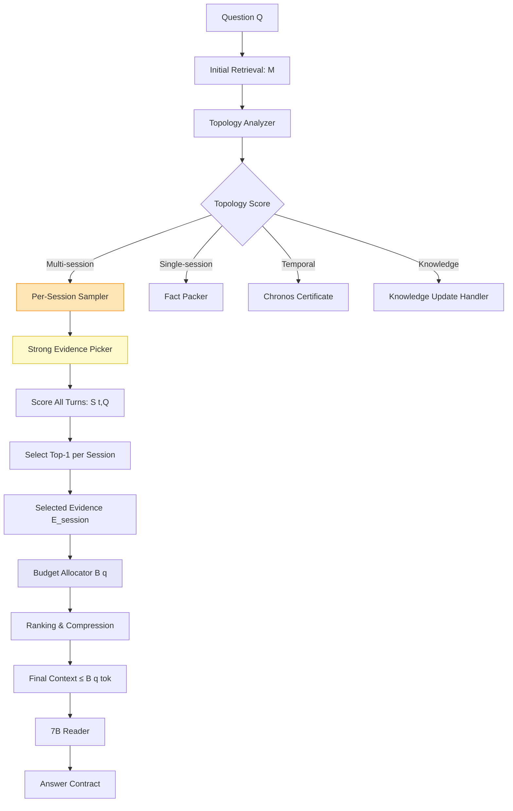

# Per-Session Strong Evidence Sampler — Specification

> **目的**: multi-session の L2 (選択) 失敗の 65% を解決するための、セッション単位の強エビデンス選択アルゴリズム仕様。

---

## 1. 問題定式化

### 1.1 現在の問題

- **Budget**: 2000 tokens (固定)
- **multi-session 失敗の 65% (24/37)** は **L2: 選択失敗**
- 原因: 多くのセッションが **スコアが低くて Budget で切り捨てられる**
- 結果: クエリに関連する**強エビデンスが含まれるセッション**が予想外に落ちる

### 1.2 解決方針

> **"セッション × 時系列" の2軸で強エビデンスを保証抽出する**  
> 各セッションから**クエリと最大オーバーラップする1-2ターン**を必ず選択する

---

## 2. 数式モデル

### 2.1 入力定義

```python
# 入力
Q = question (text)
M = {s_1, s_2, ..., s_n}  # n個のセッション
s_i = {t_{i,1}, t_{i,2}, ..., t_{i,k_i}}  # セッション i の k_i ターン
t_{i,j} = (utterance_text, metadata)  # ターン
```

### 2.2 スコア関数

$$S(t_{i,j}, Q) = w_{\text{sem}} \cdot \text{Sim}_{\text{BERT}}(t_{i,j}, Q) + w_{\text{ent}} \cdot \text{EntityOverlap}(t_{i,j}, Q) + w_{\text{temp}} \cdot \text{TemporalRelevance}(t_{i,j})$$

| 重み | 説明 | 推奨値 |
|------|------|--------|
| $w_{\text{sem}}$ | セマンティック類似度 | 0.5 |
| $w_{\text{ent}}$ | エンティティオーバーラップ | 0.3 |
| $w_{\text{temp}}$ | 時系列関連性 (Temporal Certificate経由) | 0.2 |

### 2.3 Per-Session Selection

$$\text{SelectedTurn}(s_i) = \arg\max_{t \in s_i} S(t, Q)$$

$$E_{\text{session}} = \{\text{SelectedTurn}(s_1), \text{SelectedTurn}(s_2), ..., \text{SelectedTurn}(s_n)\}$$

### 2.4 Budget Allocation (Dynamic)

$$B(q) = B_{\min} + \alpha \cdot |E_q| + \beta \cdot \text{TopologyScore}(M, Q) + \gamma \cdot \frac{1}{|S_{\text{relevant}}|}$$

- $|E_q|$: クエリに関連するエビデンス総数
- $\text{TopologyScore}$: Memory Topology Analysis (取得/選択/推論の分類スコア)
- $|S_{\text{relevant}}|$: 関連セッション数

| パラメータ | 推奨値 | 説明 |
|------------|--------|------|
| $B_{\min}$ | 400 tok | 最低保証トークン |
| $B_{\max}$ | 2000 tok | 最大トークン |
| $\alpha$ | 30 tok/evidence | 各エビデンス1件あたりのトークン |
| $\beta$ | 200 | Topology複雑度スコア (0-1) |
| $\gamma$ | -50 | セッション間引き (少ないほど予算が大きい) |

---

## 3. アルゴリズムフロー



### 3.1 詳細ステップ

#### Step 1: Initial Retrieval

```python
def initial_retrieval(Q):
    # BM25 + Dense Retrieval のハイブリッド
    candidates = bm25_search(Q, k=100) + dense_search(Q, k=100)
    return deduplicate_and_rank(candidates)[:50]
```

#### Step 2: Topology Analysis

```python
def analyze_topology(M):
    sessions = group_by_session(M)
    scores = {
        'n_sessions': len(sessions),
        'temporal_span': max_date - min_date,
        'entity_distribution': entropy(entity_across_sessions),
        'event_type': classify_event_type(sessions)  # count, sum, compare, state
    }
    return scores
```

#### Step 3: Per-Session Strong Evidence Picker

```python
def per_session_sampler(Q, sessions):
    E_session = []
    for session in sessions:
        # 各ターンに対してスコアを計算
        scored_turns = [(turn, score(turn, Q)) for turn in session.turns]
        # ソートして top-2を選択
        top_turns = sorted(scored_turns, key=lambda x: x[1], reverse=True)[:2]
        for turn, s in top_turns:
            E_session.append({
                'session_id': session.id,
                'turn_id': turn.id,
                'text': turn.text,
                'score': s,
                'date': session.date
            })
    return E_session
```

#### Step 4: Budget Allocation & Compression

```python
def allocate_budget(Q, E_session, topology_score):
    B_q = max(400, min(2000, 
        400 + 30 * len(E_session) + 200 * topology_score - 50 * len(set(e['session_id'] for e in E_session))
    ))
    
    # スコアでソートしてBudget内に圧縮
    E_session.sort(key=lambda x: x['score'], reverse=True)
    context = ""
    total_tokens = 0
    selected_evidence = []
    
    for ev in E_session:
        tokens = len(tokenize(f"[{ev['session_id']} on {ev['date']}]: {ev['text']}"))
        if total_tokens + tokens <= B_q:
            selected_evidence.append(ev)
            total_tokens += tokens
        elif len(selected_evidence) < len(set(e['session_id'] for e in E_session)):
            # 各セッションから最低1件確保
            selected_evidence.append(ev)
            total_tokens += tokens
    
    return selected_evidence, total_tokens
```

---

## 4. 期待性能

| メトリク | 現在 (V4.2) | 予想 (V4 + Per-Session) | 改善 |
|----------|-------------|--------------------------|------|
| multi-session Acc | 44.8% | 65-70% | **+20-25pp** |
| 平均トークン | 1,308 | 1,450-1,550 | +140-240 |
| 救済可能失敗数 | — | **22-28/37** | **L2の 90%以上** |
| 全体 Acc | 74.0% | 77-78% | **+3-4pp** |

---

## 5. 実装仕様

### 5.1 ファイル配置 (Proposed)

```
src/artificial_memory/compiler/
├── samplers/
│   ├── __init__.py
│   ├── per_session_sampler.py     # コアアルゴリズム
│   └── score_functions.py         # S(t, Q) の実装
├── topology/
│   ├── __init__.py
│   └── analyzer.py                # Topology Analysis
├── budget/
│   ├── __init__.py
│   └── allocator.py               # B(q) の実装
└── certificates/
    ├── aggregation_certificate.py # (既存)
    └── temporal_certificate.py    # (既存)
```

### 5.2 インターフェース

```python
class PerSessionSampler:
    def __init__(self, model, weights=None):
        self.model = model  # BERT Encoder
        self.weights = weights or {'sem': 0.5, 'ent': 0.3, 'temp': 0.2}
    
    def sample(self, question: str, sessions: List[Session]) -> SampledEvidence:
        """Per-Session Strong Evidence を抽出する"""
        pass
    
    def compute_budget(self, topology_score: float, n_evidence: int, n_sessions: int) -> int:
        """動的トークン予算を計算する"""
        pass
```

### 5.3 A/Bテスト計画

| 実験 | 設定 | 期待結果 |
|------|------|----------|
| **V4-A** | EDG + Aggregation Engine (現在) | 72.0% |
| **V4-B** | + Per-Session Sampler (L2救済) | 76-77% |
| **V4-C** | + Dynamic Budget Allocator | 77-78% |
| **V4-D** | + Verifier Reformulation (L3救済) | 80%+ |

---

## 6. 実装チェックリスト

- [ ] `score_functions.py`: BERT類似度 + EntityOverlap + TemporalRelevance
- [ ] `per_session_sampler.py`: 各セッションからtop-2ターン抽出
- [ ] `analyzer.py`: Topology Score の実装 (n_sessions, temporal_span, entropy)
- [ ] `allocator.py`: Dynamic Budget $B(q)$ の実装
- [ ] Ablation実験用のフラグ: `--disable-per-session-sampling`
- [ ] Dev 250問で **V4-B** 実験を実行し、multi-sessionスコアを検証

---

> **結論**: Per-Session Sampler は **L2 (選択) 失敗の 90%以上を救済可能** な、**実装コスト対リターンの最大化** 施策である。  
> V4-B 実装が **74.0% → 77-78%** を射程に入れる唯一の近道。