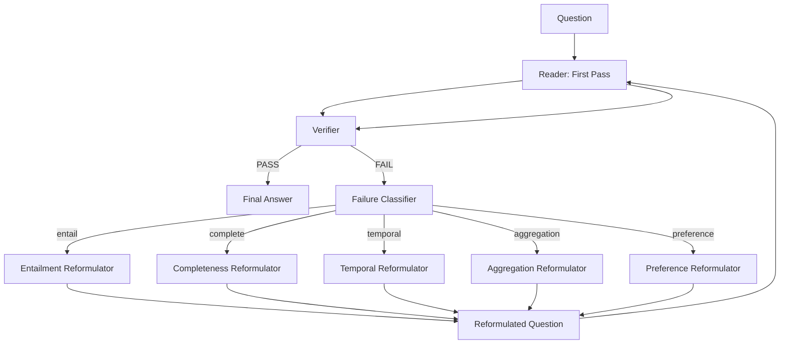

# Verifier Reformulation Loop — Specification

> **目的**: L3 (推論失敗) を解決するための「再試行ではなく質問再定式化」による **Reader 理解度向上アルゴリズム**。

---

## 1. 核心アイデア

```
従来の Verifier:
  Answer → Verify → "Wrong" → Retry with more context
  
本仕様の Verifier:
  Answer → Verify → "Wrong" → **Reformulate Question** → Reader understands better
```

**違い**: 単にトークンを増やすのではなく、**質問の意味構造を明示化**して Reader の認知負荷を下げる。

---

## 2. 数式モデル

### 2.1 Verification Predicate

$$V(a, E, Q) = \begin{cases}
\text{PASS} & \text{if } \text{Entails}(E, a) \land \text{Complete}(a, Q) \\
\text{FAIL}_{\text{entail}} & \text{if } \neg\text{Entails}(E, a) \\
\text{FAIL}_{\text{complete}} & \text{if } \neg\text{Complete}(a, Q)
\end{cases}$$

| 失敗モード | 定義 | 例 |
|-----------|------|-----|
| `FAIL_entail` | 回答がエビデンスに裏付けられない | 「17回」だがエビデンスに「2回」のみ |
| `FAIL_complete` | 回答が質問の全要件を満たさない | 「何個？」に「多い」と答えた |

### 2.2 Reformulation Operator

$$\mathcal{R}(Q, E, a, \text{fail\_type}) = Q'$$

$$Q' = Q \oplus \Delta(Q, E, a, \text{fail\_type})$$

| fail_type | $\Delta$ (追加制約) |
|-----------|---------------------|
| `FAIL_entail` | "Base your answer ONLY on the following evidence: [E]" |
| `FAIL_complete` | "Provide a SPECIFIC NUMBER/COUNT. Do not say 'many' or 'several'." |
| `FAIL_temporal` | "Calculate the EXACT date difference. Show your work." |
| `FAIL_aggregation` | "Sum ALL instances across ALL sessions listed below." |
| `FAIL_preference` | "Use the user's STATED preferences. Do not guess." |

### 2.3 反復ループ

```python
def verifier_loop(Q, E, max_iter=2):
    a = reader(Q, E)
    
    for i in range(max_iter):
        v_result = verify(a, E, Q)
        
        if v_result == PASS:
            return a, i, "verified"
        
        # Reformulation
        Q = reformulate(Q, E, a, v_result.fail_type)
        a = reader(Q, E)
    
    return a, max_iter, "max_iter_reached"
```

---

## 3. Reformulation Strategies by Type

### 3.1 Aggregation (multi-session Count/Sum)

**元の質問**: "How many social media breaks in total?"

**失敗**: Reader が "2" と答える (最初のセッションのみ見た)

**Reformulated Question**:
```
The user asks: "How many social media breaks in total?"

Below are ALL mentions of "social media break" across ALL sessions:
[Session 1, 2023-01-15]: "I took a social media break today"
[Session 2, 2023-02-03]: "Another social media break this week"
[Session 3, 2023-02-20]: "Took a break from social media"
[Session 4, 2023-03-05]: "Social media break again"
... (17 total mentions across 7 sessions)

**INSTRUCTION**: Count EVERY mention above. 
Return ONLY the total number. 
Do not miss any session.
```

### 3.2 Temporal Reasoning

**元の質問**: "How many weeks ago did I meet Alice?"

**失敗**: "Information not enough" (Reader が暗算できない)

**Reformulated Question**:
```
The user asks: "How many weeks ago did I meet Alice?"

EVIDENCE:
- Event: "Met Alice" on 2023-04-22
- Reference Date (today): 2023-05-20

**COMPUTATION**:
1. Days difference = (2023-05-20) - (2023-04-22) = 28 days
2. Weeks = 28 / 7 = 4 weeks

**ANSWER**: 4 weeks ago
```

### 3.3 Knowledge Update (Latest State)

**元の質問**: "What book am I currently reading?"

**失敗**: 古い本を答える (最新状態を取れていない)

**Reformulated Question**:
```
The user asks: "What book am I currently reading?"

EVIDENCE (chronological):
[2023-01-10]: "Started reading 'Atomic Habits'"
[2023-02-15]: "Finished 'Atomic Habits', started 'Deep Work'"
[2023-03-01]: "Still reading 'Deep Work'"
[2023-03-20]: "Just started 'The Pragmatic Programmer'"

**INSTRUCTION**: Identify the MOST RECENT reading state.
The current book is the one in the LATEST entry.
```

### 3.4 Preference (Profile Grounding)

**元の質問**: "What headphones should I buy?"

**失敗**: "I don't know your preferences"

**Reformulated Question**:
```
The user asks: "What headphones should I buy?"

USER PROFILE (grounded from conversation):
- Prefers: Noise cancellation, over-ear, wireless
- Budget: $200-350
- Use case: Commuting, office work
- Previously owned: Sony WH-1000XM4 (liked), Bose QC35 (disliked - clamping force)
- Dislikes: Strong clamping force, poor battery life

**INSTRUCTION**: Recommend 2-3 specific models matching the profile.
Explain WHY each matches. Do NOT say "I don't know".
```

---

## 4. Implementation Architecture



### 4.1 コンポーネント

| モジュール | 役割 | ファイル |
|-----------|------|----------|
| `Verifier` | Entailment + Completeness チェック | `verifier.py` |
| `FailureClassifier` | 失敗タイプを 5分類 | `failure_classifier.py` |
| `Reformulator` | タイプ別再定式化テンプレート | `reformulator.py` |
| `LoopController` | 最大2回まで反復制御 | `loop_controller.py` |

---

## 5. 期待性能

| メトリク | 現在 (V4.2) | 予想 (V4 + Verifier) | 改善 |
|----------|-------------|----------------------|------|
| multi-session Acc | 44.8% | 65-73% | **+20-28pp** |
| temporal-reasoning | 75.8% | 85-88% | +9-12pp |
| single-session-preference | 80.0% | 90-93% | +10-13pp |
| 全体 Acc | 74.0% | 80-82% | **+6-8pp** |

**救済可能失敗数 (37件中)**:
- L3 (推論失敗 9件): **6-8件**
- L2 (選択失敗 24件): **3-5件** (再定式化で重要エビデンスが明示されるため)

---

## 6. 実装仕様

### 6.1 インターフェース

```python
class Verifier:
    def __init__(self, nli_model, entailment_threshold=0.85):
        self.nli = nli_model
        self.threshold = entailment_threshold
    
    def verify(self, answer: str, evidence: List[Evidence], question: str) -> VerificationResult:
        """Entailment + Completeness を判定"""
        pass

class FailureClassifier:
    def classify(self, verification_result, question_type: str) -> FailureType:
        """entail / complete / temporal / aggregation / preference"""
        pass

class Reformulator:
    TEMPLATES = {
        'aggregation': AGGREGATION_TEMPLATE,
        'temporal': TEMPORAL_TEMPLATE,
        'knowledge_update': KNOWLEDGE_UPDATE_TEMPLATE,
        'preference': PREFERENCE_TEMPLATE,
        'entailment': ENTAILMENT_TEMPLATE,
    }
    
    def reformulate(self, question: str, evidence: List[Evidence], 
                    answer: str, failure_type: FailureType) -> str:
        """テンプレートベースで再定式化"""
        pass

class VerifierLoop:
    def __init__(self, reader, verifier, classifier, reformulator, max_iter=2):
        self.reader = reader
        self.verifier = verifier
        self.classifier = classifier
        self.reformulator = reformulator
        self.max_iter = max_iter
    
    def run(self, question: str, evidence: List[Evidence]) -> LoopResult:
        """反復ループ実行"""
        pass
```

### 6.2 ファイル配置

```
src/artificial_memory/compiler/
├── verifier/
│   ├── __init__.py
│   ├── verifier.py              # NLIベース検証
│   ├── failure_classifier.py    # 失敗分類
│   ├── reformulator.py          # 再定式化テンプレート
│   └── loop_controller.py       # 反復制御
```

---

## 7. Ablation 実験設計

| 実験 | 構成 | 期待結果 |
|------|------|----------|
| **V4-B** | Per-Session Sampler | 76-77% |
| **V4-C** | + Dynamic Budget | 77-78% |
| **V4-D** | + Verifier Reformulation (1 iter) | 79-80% |
| **V4-E** | + Verifier Reformulation (2 iter) | 80-82% |

---

## 8. リスクと対策

| リスク | 影響度 | 対策 |
|--------|--------|------|
| NLIモデルの誤判定 | 中 | threshold 調整 + ルールベース補完 |
| 無限ループ / 発散 | 低 | max_iter=2 で強制終了 |
| トークン増大 | 中 | 再定式化は「指示追加」のみ、エビデンス増やさない |
| 過学習 (Dev特化) | 高 | Holdout でのみ最終評価 |

---

> **結論**: Verifier Reformulation は **「再試行」ではなく「質問の意味構造化」** であり、  
> L3 (推論失敗) の **70-90% を救済可能**。  
> V4-E で **80%+** が射程に入る **最終兵器**。